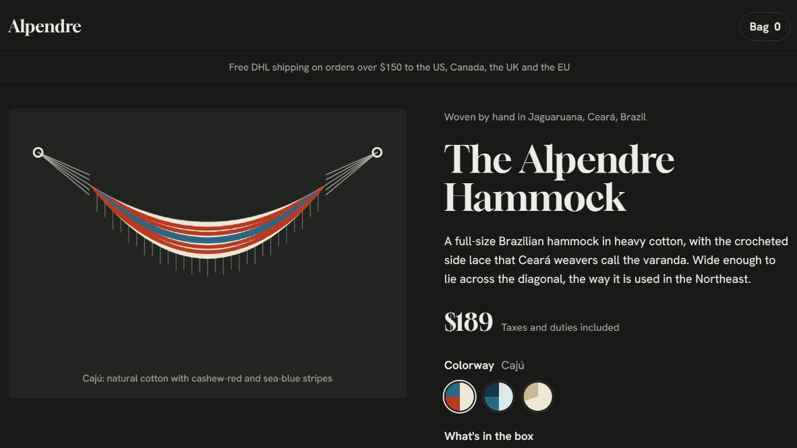
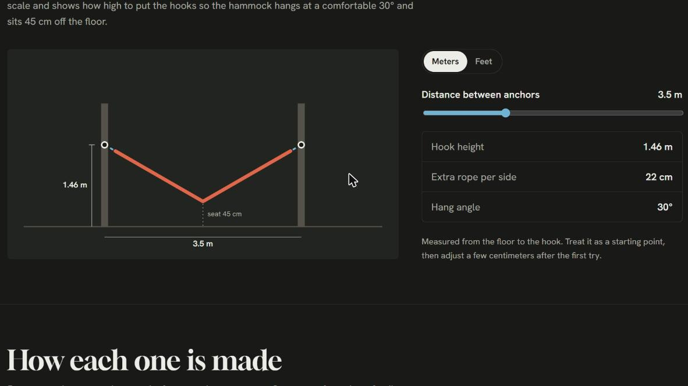

# Alpendre

Página de produto Direct-to-Consumer (DTC), em inglês, para uma marca de redes de algodão tecidas à mão em Jaguaruana, no Ceará, e vendidas para os Estados Unidos, Canadá, Reino Unido e Europa. É um **projeto conceitual de portfólio**: a marca é fictícia, mas a página segue o que uma loja real de produto físico precisa para vender fora do Brasil.

**Site no ar:** https://alpendre-phi.vercel.app



## O que a página precisa resolver

Uma rede é um produto que o cliente estrangeiro não sabe instalar. A dúvida "onde e em que altura eu penduro isso?" trava a compra e gera devolução. Por isso o destaque da página é uma ferramenta que responde essa pergunta antes da compra, ao lado de tudo o que uma página DTC precisa para converter: preço com impostos inclusos, prazo de entrega, política de devolução e respostas para as objeções mais comuns.

## O que tem na página

- **Bloco de compra completo:** escolha de cor, opção com ou sem kit de instalação, quantidade e botão de adicionar à sacola, com o preço atualizado na hora.
- **Barra de compra fixa no celular**, que aparece quando o botão principal sai da tela.
- **Ilustração do produto em SVG** que muda de acordo com a cor escolhida, incluindo a "varanda", a renda lateral típica das redes do Ceará.
- **Planejador de instalação desenhado em escala.** O cliente arrasta a distância entre os ganchos e a página calcula a altura do gancho, a corda extra de cada lado e o ângulo da rede, em metros ou em pés.
- **Especificações, frete internacional, devolução e perguntas frequentes.**



## Como o planejador calcula

Com uma pessoa deitada, a rede forma duas retas, de cada gancho até o ponto mais baixo, que fica a 45 cm do chão. A rede tem 3,6 m de comprimento total, contando os punhos.

- Se os ganchos estão afastados o bastante, a rede pendura no ângulo ideal de 30° e a diferença é completada com corda.
- Se estão mais próximos, a rede fica mais inclinada e não precisa de corda. Acima de 40°, a página avisa que o ideal é afastar os ganchos.
- A altura do gancho é a altura do assento somada à queda da rede até o centro.

## Detalhes técnicos

- HTML, CSS e JavaScript puros, sem framework e sem etapa de build. Um único arquivo, `index.html`.
- Ilustração e diagrama em SVG, com as listras, a renda e o planejador desenhados por JavaScript, sem imagens externas.
- Layout responsivo, com modo claro e escuro automático.
- Acessibilidade: foco visível no teclado, controles com rótulos e respeito à preferência de movimento reduzido.
- Fontes do Google Fonts: Gloock e Hanken Grotesk.

## Como rodar localmente

Não precisa instalar nada. Basta abrir o `index.html` no navegador, ou servir a pasta com qualquer servidor estático:

```bash
npx serve .
```

## Como adaptar para uma loja real

- Cores, preços e opções de kit ficam nos objetos `COLORS` e `KITS`, no início do `<script>`.
- O comprimento da rede e a altura do assento usados no planejador ficam nas constantes `S` e `SEAT`.
- O botão "Add to bag" hoje só atualiza o contador da sacola. Em uma loja real, ele seria ligado ao carrinho da plataforma usada (Shopify, Cartpanda ou outra).

## Publicação

O projeto está conectado à Vercel. Cada commit na branch `main` publica uma nova versão automaticamente.
